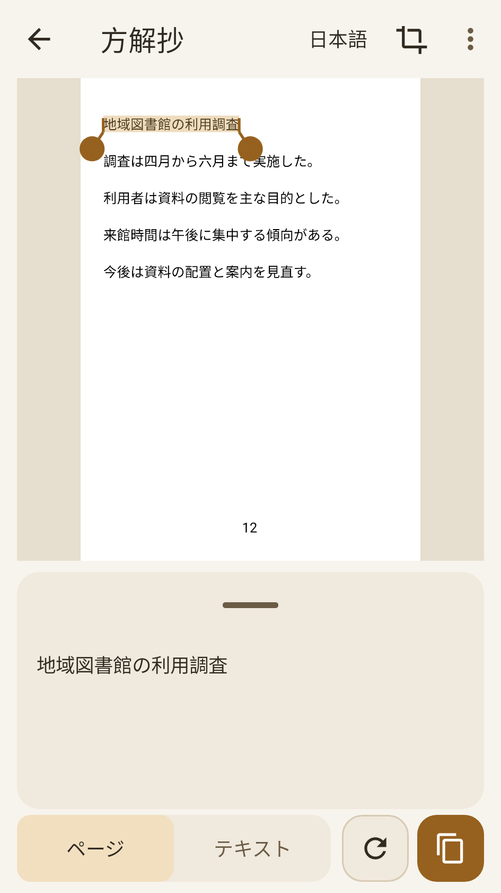
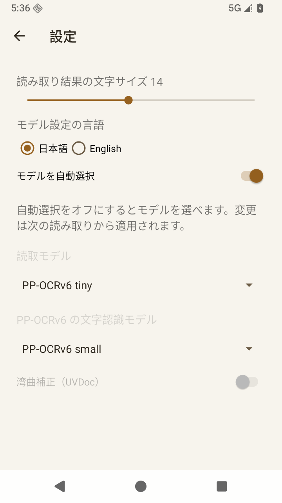

# 方解抄（ほうかいしょう）

紙の資料から、必要な文章だけをスマホで抜き出す Android アプリです。
撮影した資料や保存済みの画像を読み取り、欲しい範囲を選んでコピーできます。日本語・英語に対応し、画像と文字の認識はすべて端末内で処理します。

**[最新版の APK をダウンロード](https://github.com/sasakiy84/excerpt-memo-ocr-android/releases/latest)** · Android 16 以上

## 画面

| 画像を見ながら文章を選択 | 言語ごとに読み取りを設定 |
| --- | --- |
|  |  |

資料にはサンプル文章を使用しています。

## できること

- **撮って読み取る** — カメラで撮影するか、保存済みの画像を取り込むと自動で文字を読み取ります。
- **欲しい部分だけコピー** — 画像上の開始・終了ハンドルで文章を選択。段落内の改行を結合し、コピーしやすい形に整えます。
- **画像と文章を見比べる** — ページ表示とテキスト表示を切り替えられます。文章の欄は引き上げて高さを調整できます。
- **画像を整える** — 切り抜き・回転を手動で調整でき、湾曲したページの補正にも対応します。
- **引用する範囲を調整** — ページ番号・ルビ・表を含めるか選べます。識別できたページ番号は、コピーする引用文の末尾に付けられます。
- **オフラインで使う** — 読み取りモデルを同梱しているため、認識のための通信や追加ダウンロードは不要です。

## 使い方

1. カメラ画面で日本語・英語を選び、資料を撮影するか画像を取り込みます。
2. 読み取り結果を確認し、画像上のハンドルで抜き出したい範囲を選びます。
3. 下の文章欄を確認して、コピーボタンを押します。必要に応じて文章を訂正してからコピーできます。

## 自分に合わせて設定

読み取り結果の文字サイズは **6〜24** に変更できます。
モデルは初期設定では自動選択。自動選択をオフにすると、NDLOCR-Lite または PP-OCRv6 の tiny・small・medium を指定できます。PP-OCRv6 の文字認識モデルと UVDoc の湾曲補正も、日本語・英語それぞれで設定できます。変更は次の読み取りから適用されます。

## ライセンス・謝辞

文字の読み取りには [NDLOCR-Lite](https://github.com/ndl-lab/ndlocr-lite)（国立国会図書館、CC BY 4.0）、[PP-OCRv6](https://huggingface.co/PaddlePaddle/PP-OCRv6_small_rec_onnx)、[UVDoc](https://huggingface.co/PaddlePaddle/UVDoc_onnx)（Apache-2.0）を使用しています。画像処理には OpenCV を使用しています。DINOv3 を蒸留した検出モデルには DINOv3 License が適用されます。

各モデル・ライブラリの出典とライセンスは、アプリの「ライセンス」と [同梱ライセンス](app/src/main/assets/licenses) に収録しています。アプリ独自コードは [MIT License](LICENSE) です。
